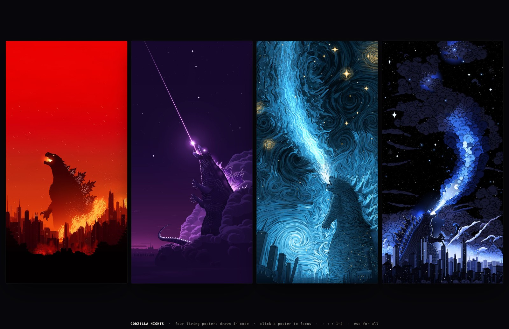

# Godzilla Nights

Four living Godzilla posters drawn entirely in JavaScript on a canvas: no images, no fonts, no libraries and no network requests.



**Live:** https://chetaslua.github.io/godzilla-nights/

**One file:** [`dist/godzilla-nights.html`](dist/godzilla-nights.html). Download it and open it in any browser; it works offline.

| # | Poster | What moves |
|---|---|---|
| 1 | Red Ash | ash drifting down, fire licking the skyline, glowing dorsal plates, flame licks and embers from the open jaws |
| 2 | Violet Beam | the atomic beam shimmering, a 16-ray starburst, energy filaments at the throat, twinkling stars, rolling smoke |
| 3 | Starry Breath | painterly swirls flowing, brushstroke breath streaming from the mouth, flickering gold stars |
| 4 | Blue Plume | billowing cloud plume, beam flicker, rising sparks, twinkling stars and city lights |

## Is it really pure code?

Yes. Every pixel is drawn at runtime with Canvas 2D: gradients, paths, noise, brushstrokes, glow and grain. The repository contains no image or audio files except `docs/preview.jpg`, which is a screenshot for this README; the page never loads it.

One honest note: the posters recreate the composition of existing artwork. Poster 1's silhouette, skyline and fire shapes are stored as normalised outline coordinates that were measured from the reference. Posters 2 to 4 use hand-placed control points and colour stops. Those are numbers in the source, not embedded or sampled pixels.

## Run

```bash
open index.html            # macOS; any static file server works too
python3 tools/build.py     # inline pieces/*.js -> dist/godzilla-nights.html
```

Controls: click a poster to focus it, use ← → or 1–4 to switch, and Esc to return to the wall.

Deterministic stills: `index.html?cap&p=2&t=3.5&w=1200` renders poster 2 at t = 3.5 s and 1200 px wide.
`node tools/shot.mjs <poster> <out_prefix> <width> <t...>` saves those stills as PNGs through headless Chrome (needs Node 22+ and Google Chrome).

## How a poster works

Each file in `pieces/` registers `window.PIECES[n] = { title, init(ctx, W, H), draw(ctx, W, H, t, state, mouse) }`.
`init` prebakes the static layers into offscreen canvases once. `draw` composites them and adds the animated layers. The result is a pure function of time `t`, at about 0.3–1 ms per frame. `pieces/common.js` holds the shared helpers: seeded RNG, Perlin noise and fBm, splines, glow, sparkle and film grain.

## Credits

- Original wallpapers by [@DJames947740](https://x.com/DJames947740/status/2119256276727435376). This is an unofficial code recreation and study of that work. All credit for the compositions goes to the original artist.
- Godzilla is a trademark of Toho Co., Ltd. This is non-commercial fan art, not affiliated with or endorsed by Toho.
- The code is MIT-licensed (see `LICENSE`). The license covers the code only, not the characters or the original artwork it recreates.
